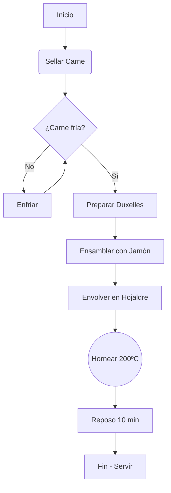
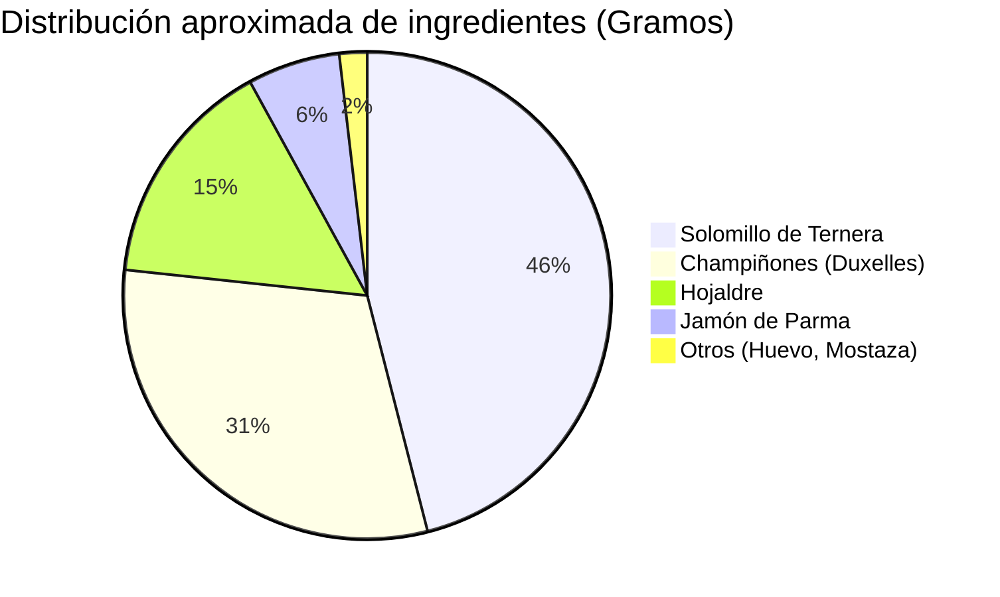
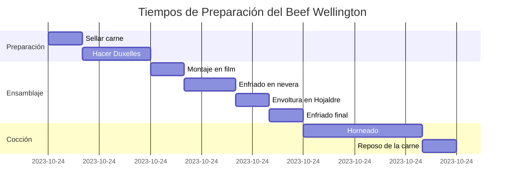
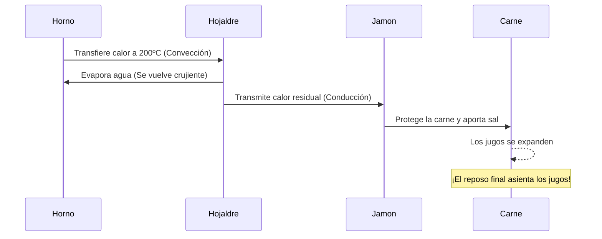

<a id="indice"></a>
# Índice de Contenidos 

- [Introducción a la Receta ](#introducción-a-la-receta-)
- [Ingredientes y Materiales ](#ingredientes-y-materiales-)
- [Proceso de Preparación ](#proceso-de-preparación-)
- [Análisis Científico y Tiempos ](#análisis-científico-y-tiempos-)
- [Referencias y Anexos ](#referencias-y-anexos-)

---

# Introducción a la Receta 
[Volver al Índice](#indice)

El **Solomillo Wellington** (o *Beef Wellington* en inglés) es una preparación clásica y elegante. Esta versión está basada en la famosa receta del chef británico ***Gordon Ramsay***. Es un plato que combina texturas crujientes, sabores intensos de la tierra y una carne jugosa.

A lo largo de los años, esta receta ha sido ~~subestimada por muchos~~ considerada el **santo grial** de las celebraciones navideñas y cenas de gala. 
En este proyecto, no solo documentaremos cómo hacerlo, sino que analizaremos el proceso desde una perspectiva estructurada.

<details>
  <summary><h3 style="display:inline-block; margin:0;"> Haz clic aquí para un dato curioso HTML</h3></summary>
  <p style="color: darkred;">¿Sabías que se cree que el nombre proviene de Arthur Wellesley, el primer Duque de Wellington, quien derrotó a Napoleón en Waterloo?</p>
</details>

> "Cocinar no se trata solo de seguir una receta, se trata de pasión, de poner tu corazón en el plato." 
> — **Gordon Ramsay**

> [!NOTE]
> Esta receta está pensada para 4-6 personas. Lee todo el documento antes de empezar a cocinar para organizar bien tus tiempos.

---

# Ingredientes y Materiales 
[Volver al Índice](#indice)

Para conseguir el éxito en esta receta, es fundamental tener *mise en place* (todo preparado y en su sitio). 

### Lista de la Compra 

*   **Carnes y Lácteos:**
    *   750g de centro de solomillo de ternera.
    *   10-12 lonchas de jamón de Parma.
    *   2 yemas de huevo (para pintar).
*   **Vegetales y Otros:**
    *   500g de champiñones (para la *duxelles*).
    *   1 lámina de hojaldre rectangular.
    *   Mostaza inglesa.
    *   *Opcional*: 
        *   Castañas.
        *   Tomillo fresco.

### Tablas de Organización

A continuación, se presentan tres tablas con diferentes alineaciones (Izquierda, Centrada, Derecha) para organizar los componentes:

**1. Ingredientes Principales (Alineación Izquierda)**
| Ingrediente | Cantidad | Función |
| :--- | :--- | :--- |
| Solomillo | 750g | Centro del plato |
| Hojaldre | 1 lámina | Capa exterior crujiente |
| Champiñones | 500g | Aporta humedad y sabor terroso |

**2. Herramientas Necesarias (Alineación Centrada)**
| Herramienta | Uso Principal | Alternativa |
| :---: | :---: | :---: |
| Papel Film | Envolver y dar forma | Papel de horno (menos efectivo) |
| Pincel | Pintar el hojaldre | Cuchara pequeña |
| Sartén de hierro | Sellar la carne | Sartén antiadherente gruesa |

**3. Valores Nutricionales Estimados por Ración (Alineación Derecha)**
| Calorías | Proteínas | Grasas |
| ---: | ---: | ---: |
| 650 kcal | 45 g | 35 g |
| 15% CDR | 90% CDR | 50% CDR |

### Tareas Previas a la Cocina
- [x] Comprar los ingredientes frescos.
- [ ] Limpiar los champiñones sin usar agua (usar un paño húmedo).
- [ ] Afilar los cuchillos.
- [ ] Precalentar el horno pulsando la tecla <kbd>ON</kbd> y configurando a 200ºC.

<!-- Nota interna: Asegurarse de que el hojaldre esté muy frío antes de usarlo -->

---

# Proceso de Preparación 
[Volver al Índice](#indice)

Aquí detallamos el paso a paso. Es vital respetar los tiempos de reposo en frío.

### 1. Preparación de la Carne y Duxelles
1.  **Sellar la carne:** <br>Salpimienta el solomillo. En una sartén muy caliente con aceite, sella la carne por todos sus lados (aprox. 1 minuto por lado).<br> Retira y unta inmediatamente con la mostaza inglesa mientras está caliente.
2.  **La Duxelles:**
    1.  Tritura los champiñones hasta hacer un puré grueso.
    2.  Saltéalos en una sartén seca para evaporar toda el agua.
    3.  Condimenta y reserva hasta que enfríe.

### 2. Ensamblaje
Para que el Wellington mantenga su forma cilíndrica perfecta, usaremos una técnica de programación en formato "receta":

```python
# Código Python simulando el ensamblaje lógico
def ensamblar_wellington(carne, jamon, duxelles, hojaldre):
    capa_1 = extender(papel_film)
    capa_2 = colocar(jamon, sobre=capa_1)
    capa_3 = untar(duxelles, sobre=capa_2)
    centro = colocar(carne, sobre=capa_3)
    
    rollo_interior = enrollar_apretado(centro, capa_1)
    enfriar_en_nevera(rollo_interior, tiempo="15 min")
    
    resultado_final = envolver_con(hojaldre, rollo_interior)
    return resultado_final
```

> [!WARNING]
> **Peligro de humedad:** Si no evaporas bien el agua de los champiñones, el hojaldre quedará blando y pastoso por debajo (el temido *soggy bottom*).

### Galería de Imágenes 

*Imágenes ilustrativas del proceso (Internet y Local)*


")

*Nota: La imagen local requiere que exista una carpeta `img` con el archivo en el repositorio.*

---

# Análisis Científico y Tiempos 
[Volver al Índice](#indice)

La cocina es pura química y matemáticas. Vamos a utilizar el lenguaje `LaTeX` para demostrar algunas fórmulas aplicadas a esta receta.

### Fórmulas Matemáticas con LaTeX 

1.  **Conversión de Temperatura (Fórmula en línea):** 
    Para hornear, la receta pide 200°C. Si usamos un horno estadounidense, usamos la fórmula $F = (C \times \frac{9}{5}) + 32$ para obtener 392°F.
2.  **Proporción Carne/Costra (Fórmula en línea):**
    Una buena relación de peso entre la carne ($W_c$) y la envoltura ($W_e$) es crucial: $R = \frac{W_c}{W_e} \approx 1.5$.
3.  **Cálculo del Área de Superficie del Solomillo (Cilindro) (Fórmula en bloque):**
    Para saber cuánto hojaldre necesitamos, aproximamos la carne a un cilindro de radio $r$ y longitud $h$:
    $$ A = 2\pi r h + 2\pi r^2 $$
4.  **Ley de Enfriamiento de Newton (Fórmula en bloque):**
    Para calcular la tasa de enfriamiento del Wellington en la nevera antes de hornear:
    $$ T(t) = T_a + (T_0 - T_a) e^{-kt} $$
    Donde $T(t)$ es la temperatura en el tiempo $t$, y $T_a$ es la temperatura ambiente (de la nevera).
5.  **Cálculo del Coste Total (Fórmula en bloque):**
    Sumatorio del precio de $n$ ingredientes según su cantidad:
    $$ Coste\_Total = \sum_{i=1}^{n} (Precio\_Por\_Kilo_i \times Cantidad\_Kilos_i) $$

---

### Diagramas de Planificación con Mermaid 

A continuación, usamos 4 tipos de diagramas diferentes para estructurar el trabajo.

**1. Diagrama de Flujo (Flowchart): Resumen de la Receta**


**2. Gráfico de Pastel (Pie Chart): Proporción de Ingredientes por Peso**


**3. Diagrama de Gantt: Cronograma de Tiempos**


**4. Diagrama de Secuencia: Interacción de los Elementos en el Horno**


---

# Referencias y Anexos 
[Volver al Índice](#indice)

*   [Página oficial de Gordon Ramsay](https://www.gordonramsay.com/ "Web del Chef Gordon Ramsay")
*   [Receta original en YouTube](https://www.youtube.com/ "Video de la receta")
*   Archivo interno: [Ver Guía de Cortes de Carne](./cortes_carne.md "Guía local") *(Ejemplo de enlace interno)*

---
<p align="center">
  <b>Hecho con 🔪 y ❤️ para el módulo de Entornos de Desarrollo.</b><br>
  <i>(AE01_07_tunombre)</i>
</p>